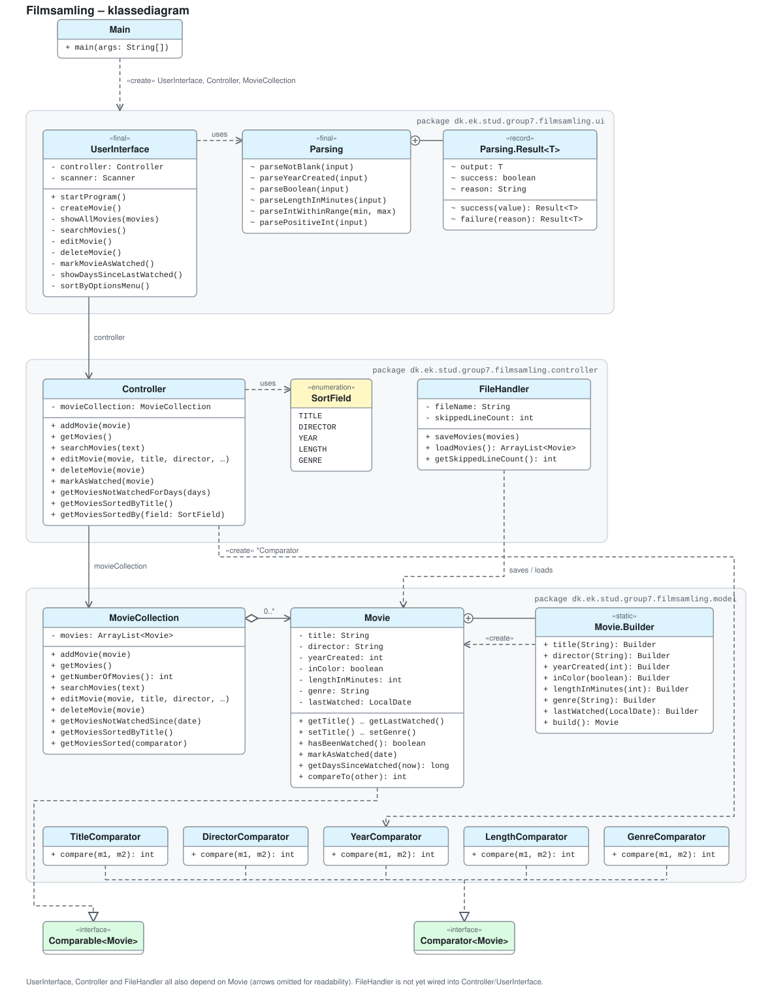

# Filmsamling

Et CRUD-program til en filmsamling - 1. semester, datamatiker, EK. 

Filmsamlingen er en digital oversigt over din personlige filmsamling.
Programmet gør det muligt at oprette, vise, søge efter redigere og slette film samt registrere, hvornår de sidst er set. 

Projektet udvikles som et terminalprogram i Java med fokus på objektorienteret programmering, unit testing, fejlhåndtering, fillagring og sortering.

## Gruppen
| Fornavn | GitHub                                        |
|---------|-----------------------------------------------|
| Nikita  | [NikitaM2527](https://github.com/NikitaM2527) |
| Mathias | [mwnDK1402](https://github.com/mwnDK1402)     |
| Nikolas | [NikolasCCT](https://github.com/NikolasCCT)   |

## Funktioner
Programmet indeholder følgende funktioner:
1. **Opret film**: Tilføj en film til samlingen med oplysninger om titel, instruktør, udgivelsesår, farve, længde, genre og dato for sidst set. 
2. **Vis film**: Se en oversigt over filmene i samlingen. 
3. **Søg efter film**: Find film ud fra titel. 
4. **Redigér film**: Opdatér oplysningerne på en eksisterende film.
5. **Slet film**: Fjern en film fra samlingen.
6. **Markér som set**: Registrér, hvornår en film sidst er blevet set.
7. **Vis sete-/ikke-sete oplysninger**: Se, hvor længe det er siden, en film sidst blev set, eller om den aldrig er blevet set. 
8. **Sortér film**: Sortér filmsamlingen efter titel, instruktør, udgivelsesår, længde eller genre.

## Fillagring
Filmsamlingen gemmes i en CSV-fil (`movies.csv`), så filmene kan indlæses igen, når programmet startes på ny. 

Programmet benytter `FileHandler` til at håndtere indlæsning og lagring af film. 
Ugyldige linjer i CSV-filen springes over, så de ikke forhindrer indlæsning af de øvrige film.

## User stories
### Implementerede user stories

### User stories, vi ikke nåede

## Sådan køres programmet
Projektet er udviklet i Java og kræver **JDK 25 (LTS)***.
Programmet startes fra klassens `Main.java`:
`dk.ek.stud.group7.filmsamling.Main`

I IntelliJ:
1. Åbn projektet i IntelliJ. 
2. Kontrollér, at projektets JDK er sat til JDK 25. 
3. Åbn `Main.java`.
4. Kør programmets `main()`-metode ved at trykke på den grønne Run-knap. 

Programmet afvikles i terminalen. 

## Faglige områder
Projektet er udviklet i Java og anvender blandt andet: 
- Objektorienteret programmering
- CRUD-operationer
- Builder Pattern
- Exceptions og fejlhåndtering
- Unit testing
- `ArrayList` og Collections
- `Comparable` og `Comparator`
- CSV til lagring af data
- Filhåndtering med `Scanner` og `PrintStream`

### Klasse diagram

<picture>
  <source media="(prefers-color-scheme: dark)" srcset="docs/class-diagram-dark.svg">
  
</picture>
